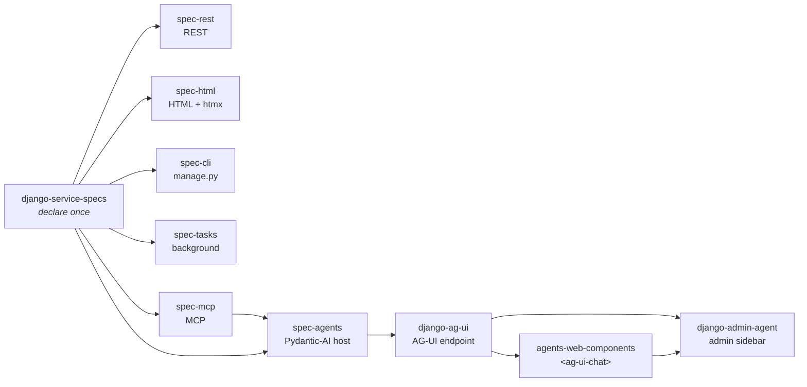

  <a href="https://github.com/Artui">
    <picture>
      <source media="(prefers-reduced-motion: reduce)" srcset="assets/tagline.svg">
      
    </picture>
  </a>

  

## What I'm building

**One operation, declared once, served everywhere.** A Django operation is declared as a *spec*: its parameters, permission check, validation and output. The same spec is then served over REST, HTML, the command line, MCP, and to AI agents, without writing it again for each.

| Package | What it does | Release |
| --- | --- | --- |
| [django-service-specs](https://github.com/Artui/django-service-specs) | The kernel: declare an operation once, dispatch it from any transport |  |
| [django-spec-rest](https://github.com/Artui/django-spec-rest) | Specs over HTTP with Django REST Framework |  |
| [django-spec-html](https://github.com/Artui/django-spec-html) | Specs as server-rendered pages, HTML first and htmx-capable |  |
| [django-spec-cli](https://github.com/Artui/django-spec-cli) | Specs as `manage.py` subcommands, options generated from parameters |  |
| [django-spec-mcp](https://github.com/Artui/django-spec-mcp) | Specs to agents over the Model Context Protocol |  |
| [django-spec-tasks](https://github.com/Artui/django-spec-tasks) | Specs as background tasks with a durable run record |  |
| [django-spec-agents](https://github.com/Artui/django-spec-agents) | A Django agent host for Pydantic-AI, with specs as tools |  |
| [django-ag-ui](https://github.com/Artui/django-ag-ui) | An AG-UI agent endpoint for Django |  |
| [agents-web-components](https://github.com/Artui/agents-web-components) | A framework-free `<ag-ui-chat>` web component: a drop-in chat sidebar with client-side tools |  |
| [django-admin-agent](https://github.com/Artui/django-admin-agent) | A chat-agent sidebar inside the Django admin |  |

See it all working together in **[django-agent-examples](https://github.com/Artui/django-agent-examples)**: one Django backend, one agent, five frontends (React, Vue, Svelte, Angular and the Django admin).

## Standalone Django libraries

| Package | What it does | Release |
| --- | --- | --- |
| [django-domain-events](https://github.com/Artui/django-domain-events) | A domain-event log with a durable outbox, per-receiver retry and dead-letter |  |
| [django-outbound-webhooks](https://github.com/Artui/django-outbound-webhooks) | Customer-facing webhooks with Standard Webhooks signing |  |
| [django-query-contract](https://github.com/Artui/django-query-contract) | Catch N+1s, query growth and bad plans at test time |  |
| [django-data-shape](https://github.com/Artui/django-data-shape) | A realistically shaped test database from your models, loaded by `COPY` |  |
| [django-tiptap-editor](https://github.com/Artui/django-tiptap-editor) | A drop-in TipTap rich-text editor for Django forms and admin |  |

**Also:** [go-services](https://github.com/Artui/go-services), the same declare-once idea for Go, and [held-back-check](https://github.com/Artui/held-back-check), a GitHub Action that says which dependency holds another below its newest release.

## How I work

  
  
  
  

A fix lands with the test that failed before it.

## Activity

  
  
  

<picture>
  <source media="(prefers-color-scheme: dark)" srcset="https://raw.githubusercontent.com/Artui/Artui/output/github-snake-dark.svg">
  
</picture>

